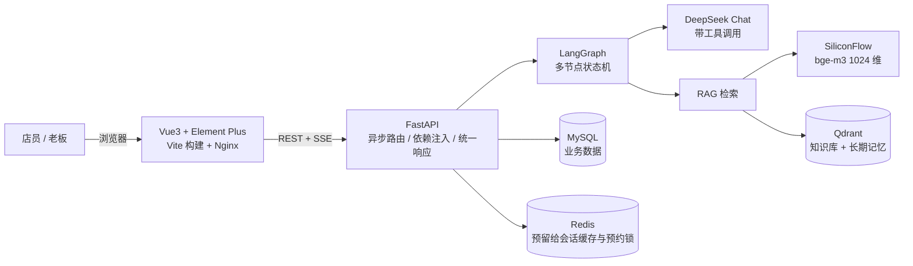
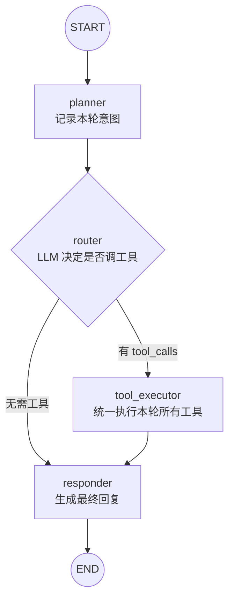

# SalonFlow · 美发门店多 Agent 经营服务智能体

> 让社区美发小店的老板，用一句话完成查会员、看库存、排预约、生成营销文案和经营报表。

社区美发门店的典型困境是：客流、会员、库存、技师排班、工单记录分散在微信、纸本和脑子里，老板既要接客又要记账。SalonFlow 把这些动作收进一套「对话即操作」的多 Agent 系统——店员说一句话，智能体自己决定去查数据、检索知识库还是起草一个待确认的写操作，最后由人点一下确认才真正落库。

后端 **FastAPI + LangGraph**，前端 **Vue3 + Element Plus**，RAG 走 **Qdrant + bge-m3**，整套服务 **Docker Compose 一键启动**。

<!--
截图补充说明（补完就删除这段注释）：
1. 启动项目后，把 5 张截图存到 docs/images/，文件名建议：
   login.png / dashboard.png / agent-chat.png / knowledge.png / report.png
2. 每张宽度控制在 1600px 以内，png 压缩后单张 < 800KB
3. 录一段 10 秒的对话 GIF 放 docs/images/demo.gif，效果最好
-->

## 界面预览

> 截图待补充：登录页 / 经营看板 / Agent 悬浮窗对话 / 知识库管理 / 报表导出

## 功能

| 模块 | 能力 |
|---|---|
| 会员管理 | 会员档案、余额、标签、发质备注，支持按姓名/手机号检索 |
| 预约排班 | 预约创建与状态流转（待确认 / 已确认 / 已完成 / 已取消），按技师与手机号筛选 |
| 物料库存 | 库存台账、安全阈值、低库存自动预警，出入库流水 |
| 服务工单 | 订单记录、金额与消费明细 |
| 经营报表 | 营收与订单统计，Excel 导出 |
| 知识库 | 门店知识/护理问答入库，向量检索增强回答 |
| Agent 助手 | 右下角悬浮窗，SSE 流式对话，可查数据、检索知识、起草写操作 |
| 权限 | JWT 登录，老板 / 技师 / 前台三角色隔离 |

## 系统架构



## Agent 工作流



四个节点在同一条 LangGraph 状态机上流转，`router` 通过条件边决定走向；工具结果、RAG 片段、待确认动作统一写回 `AgentState`，供 `responder` 拼装最终回答。

## 技术栈

| 层 | 技术 |
|---|---|
| 智能体编排 | LangGraph（StateGraph、条件边、多节点状态流转） |
| LLM | LangChain + DeepSeek Chat（工具绑定 `bind_tools`） |
| 后端 | FastAPI（异步、SSE 流式、APIRouter、依赖注入、全局异常、统一响应体） |
| 前端 | Vue3 + Vite + Element Plus + ECharts |
| 业务库 | MySQL 8 + SQLAlchemy 2.0（异步 ORM） |
| 向量库 | Qdrant（知识库检索 + 长期记忆召回） |
| Embedding | SiliconFlow bge-m3（1024 维，余弦相似度） |
| 缓存 | Redis（已编排，业务侧预留） |
| 部署 | Docker Compose + Nginx 反向代理 |

## 核心实现与设计取舍

### 1. LLM 不能直接改数据库：写操作一律「先出方案，再二次确认」

`tools.py` 里的工具被分成两类：

- **只读**：`query_members` / `query_inventory` / `query_reservations`，直接查库返回结果
- **写**：`propose_create_reserve` / `propose_create_member` / `propose_stock_change`，**只生成方案文本，不写库**

`tool_executor` 节点在执行 `propose_*` 时，把参数挂到 `pending_action` 返回给前端；用户点确认后，前端调 `/agent/execute`，才由 `actions.py` 复用 `services` 层原有的校验逻辑真正落库。

这么设计的原因很直接：让大模型拥有 DELETE/UPDATE 权限，一次幻觉就是一条脏数据或一个被删掉的会员。把「决策」和「执行」切开，人始终握着最后一道开关，同时复用 service 层已有的业务校验，不必再维护一套 Agent 专用写接口。

### 2. 工具执行合并为单节点，规避 OpenAI 兼容接口的 400

`tool_executor` 把本轮所有 tool_calls 在一个节点内遍历执行，而不是按工具拆成多个节点。原因是：一轮对话里模型可能同时调用 `search_knowledge` 和一个业务工具，如果拆成并联的多节点，某个分支提前结束会让 `tool_call_id` 缺少对应的 `ToolMessage`，DeepSeek/OpenAI 兼容接口会直接返回 `400 invalid_request_error`。合并后每个 `tool_call_id` 都保证有回执，异常也用 `ToolMessage` 兜底（`工具执行失败：...`），不会让整轮对话崩掉。

### 3. RAG 直连 Qdrant REST，绕开依赖冲突

没有引入 `qdrant-client` 或 `langchain-qdrant`，而是用 `httpx` 直接调 Qdrant 的 REST API（`rag.py`）。原因是这两个库与当时环境的 `pydantic 2.14` / `openai 3.x` 存在版本冲突，装上一个就会打断另一条链路。直连只用到建集合、批量 upsert、查询三个接口，反而把依赖面收窄到最小。

配套细节：向量维度固定 1024、距离算法 Cosine、集合不存在时自动创建，embedding 返回的 `data` 按 `index` 排序后再使用（批量接口返回顺序不保证与输入一致，这点不处理会造成文本与向量错位）。

### 4. 长期记忆：抽取、去重、按用户隔离召回

`memory.py` 在每轮对话结束后用一次 LLM 调用抽取「值得长期记住的事实」（输出 JSON 数组），去重后写入 Qdrant 的 `salonflow_memory` 集合，payload 里带 `user_id`。下一轮提问前，按 `user_id` 做 payload 过滤再向量召回，把结果拼进 system prompt。

几个防呆点：单轮最多抽 5 条（`MAX_MEMORIES_PER_TURN`）防止记忆膨胀；召回失败一律返回空列表，记忆服务挂了不能影响主对话；和业务数据一样，记忆按用户隔离，避免 A 店员的顾客偏好串到 B 店员那里。

### 5. 双层会话记忆 + 流式输出的降级兜底

会话层 `chat_session` 记录一次对话的边界，历史层 `chat_history` 存逐条消息。回答前按 `session_id` 加载历史转成 LangChain 消息注入上下文。

流式走 `sse_starlette` 的 `EventSourceResponse`；**未配置回答模型时**，`_fallback_answer` 直接把检索片段整理成回答返回，保证知识库问答在没 Key 的环境下也能演示，而不是抛 500。

## 目录结构

```
SalonFlow/
├── backend/
│   ├── app/
│   │   ├── main.py            # 入口：统一响应 / 全局异常 / 启动建表与种子数据
│   │   ├── core/              # 配置、JWT、异步数据库、响应封装
│   │   ├── models/            # SQLAlchemy ORM 模型
│   │   ├── schemas/           # Pydantic 校验模型
│   │   ├── services/          # 业务逻辑层（报表、库存、预约、会员）
│   │   ├── api/v1/            # 路由层
│   │   └── agent/             # Agent 核心
│   │       ├── graph.py       # LangGraph 状态机（四节点 + 条件边）
│   │       ├── tools.py       # 只读查询工具 + 写操作方案工具
│   │       ├── rag.py         # bge-m3 向量化 + Qdrant 检索
│   │       ├── memory.py      # 长期记忆抽取与召回
│   │       ├── actions.py     # 用户确认后的写操作落库
│   │       └── state.py       # AgentState 定义
│   ├── Dockerfile
│   └── .env.example
├── frontend/
│   ├── src/                   # Vue3 页面与 Agent 悬浮窗组件
│   ├── Dockerfile
│   └── nginx.conf
├── docker-compose.yml         # MySQL + Qdrant + Redis + 后端 + 前端
└── README.md
```

## 快速启动

### 方式一：Docker Compose 一键部署（推荐）

```bash
# 1. 复制环境变量模板，填上自己的模型 Key
cp backend/.env.example backend/.env

# 2. 构建并启动整套服务
docker compose up -d --build
```

| 入口 | 地址 |
|---|---|
| 前端 | http://localhost:8080 |
| 接口文档 | http://localhost:8080/api/docs |
| 健康检查 | http://localhost:8080/api/health |

默认账号 `admin / admin123`。

生产环境建议通过环境变量注入密钥，不写进镜像：

```bash
SECRET_KEY=xxx DEEPSEEK_API_KEY=sk-xxx EMBEDDING_API_KEY=xxx docker compose up -d --build
```

> 容器内 MySQL 以主机名 `mysql:3306` 访问，宿主机映射 `3307` 供本地开发；Redis 已编排进 compose，业务侧暂未接入。

### 方式二：本地开发

```bash
# 1. 启动基础设施
docker compose up -d mysql qdrant redis

# 2. 后端
cd backend
python -m venv .venv
.venv\Scripts\activate           # Windows
pip install -r requirements.txt
copy .env.example .env
uvicorn app.main:app --reload --port 8000

# 3. 前端
cd frontend
npm install
npm run dev
```

访问 http://localhost:5173 ，接口文档 http://localhost:8000/api/docs 。

## 环境变量

| 变量 | 说明 |
|---|---|
| `SECRET_KEY` | JWT 签名密钥，部署前务必替换 |
| `MYSQL_*` | 数据库连接（本地开发默认端口 3307） |
| `DEEPSEEK_API_KEY` | 对话模型 Key，留空则聊天走知识库降级回答 |
| `EMBEDDING_API_KEY` / `EMBEDDING_BASE_URL` | bge-m3 向量化服务 |
| `QDRANT_URL` | 向量库地址，默认 http://127.0.0.1:6333 |

`.env` 已在 `.gitignore` 中，仓库里只保留 `.env.example` 模板。

## 实施进度

| 阶段 | 内容 | 状态 |
|---|---|---|
| 0 | 项目脚手架、统一响应、全局异常、Docker | 已完成 |
| 1 | JWT 登录与三角色权限 | 已完成 |
| 2 | 会员 / 技师 / 库存 / 预约 / 订单 CRUD | 已完成 |
| 3 | Agent 编排：LangGraph 四节点 + 工具 + SSE | 已完成 |
| 4 | 右下角 Agent 悬浮窗（流式对话） | 已完成 |
| 5 | RAG 知识库（Qdrant + bge-m3） | 已完成 |
| 6 | 长期记忆（抽取 / 去重 / 按用户召回） | 已完成 |
| 7 | 报表与预警（营收统计、Excel 导出） | 已完成 |
| 8 | Docker 一键部署与 Nginx 反代 | 已完成 |

## 后续计划

- 预约冲突检测接入 Redis 分布式锁（compose 已预留组件）
- Agent 增加多轮任务规划，支持一句话串联「查库存 → 出方案 → 确认入库」
- 报表增加同比环比与技师绩效维度

## License

MIT
